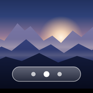

# Aerial Home



An ad-free home screen for rooted LG webOS TVs: aerial video behind a clean glass
interface, your apps in a dock, the rest one press away.

- **Scenes**: a library of ~200 aerials streamed from Apple and the Aerial community
  (a starter set plays out of the box), plus clips stored on the TV for instant,
  offline playback. ↑ opens the scene picker.
- **Dock and drawer**: favourite apps in the dock, everything else in “More apps” (↓).
  HDMI inputs can sit in the dock too. Real icons, read from the TV.
- **Icons**: one style for all apps (TV icons, App Store artwork, or monochrome logos
  on glass), or a different icon per app or HDMI input, searched live in the App Store,
  Dashboard Icons and Simple Icons. Your own image files beat everything.
- **Settings**: apps (dock / more apps / hidden, reorder), scenes and library,
  icons, appearance (glass style and tint, icon size, names, dimming, clock, greeting,
  date, weather), language (follows the TV, or English / Deutsch), weather (any place,
  searched by name; defaults to the TV's time zone), inputs, behaviour.
- **Replaces LG's home screen**: the Home button opens Aerial Home, and it comes back
  at power-on and whenever an app closes. LG's home stays reachable from the drawer.
- Remote and Magic Remote pointer (hover, click, wheel).

Built for and tested on an LG UP80 with webOS 6.5 (Chromium 79). Other webOS 6+ TVs
should work but haven't been tested; reports welcome.

## Requirements

- A rooted TV with the [Homebrew Channel](https://github.com/webosbrew/webos-homebrew-channel)
  and root SSH enabled.
- [LG Input Hook](https://repo.webosbrew.org/apps/org.webosbrew.inputhook/) for the
  Home button (optional; everything else works without it).

## Install

Download `io.aerialhome_<version>_all.ipk` from the
[releases](https://github.com/samyn92/aerial-home/releases), then:

```sh
scp -O io.aerialhome_*_all.ipk root@<tv>:/media/developer/temp/
ssh root@<tv> 'sleep 120 | timeout -t 110 luna-send -i luna://com.webos.appInstallService/dev/install \
  "{\"id\":\"io.aerialhome\",\"ipkUrl\":\"/media/developer/temp/$(ls /media/developer/temp | grep aerialhome)\",\"subscribe\":true}"'
```

Or from a checkout: `TV=root@<tv> tools/deploy.sh` (builds, installs and launches).

Then open **Settings → Behaviour** and switch on *Replace LG's home screen* and
*Home button opens Aerial Home*.

**Turn on Quick Start+** (TV settings → General). Without it every power-on is a full
boot: webOS only lets homebrew start ~40 s in, so Aerial Home appears late. With it,
the TV wakes in a few seconds straight back into Aerial Home.

### Scenes

Out of the box a starter set streams from Apple. **Settings → Library** lists every
scene (OK previews it, ← → adds it to your scenes). Thumbnails are Apple's own preview
images, fetched once by the TV into the app folder (~45 KB each); community scenes,
which have none, get a drawn placeholder.

Streaming needs a decent connection for 4K. For instant switching and no network use,
store clips on the TV: `tools/scenes.tsv` lists them (slug, title, source URL), and
`TV=root@<tv> tools/push-scenes.sh` cuts each to 60 s, re-encodes it as 4K HEVC
(~65 MB, needs macOS for the hardware encoder), makes a thumbnail and a first-frame
poster, and copies everything plus `scenes.json` to `/media/developer/aerial-home/scenes/`
(outside the app, so reinstalls keep it). The app reads that list at start.

## Icons

**Settings → Icons** sets the look:

- **Icon style** (← →): *TV icons* as installed, *App Store* (the app's artwork from the
  iTunes Search API) or *Monochrome* (white brand logos from Simple Icons on glass;
  apps without a logo get their first letter). Each app is looked up once and kept
  only on a clear name match. System apps and homebrew tools are never looked up,
  and inputs keep their glass input tile unless you pick an icon for them.
- **Per app or input** (OK on it): the picker shows candidates from the
  [App Store](https://developer.apple.com/library/archive/documentation/AudioVideo/Conceptual/iTuneSearchAPI/),
  [Dashboard Icons](https://github.com/homarr-labs/dashboard-icons) (full-colour logos
  on a light tile, and the same logos in white) and [Simple Icons](https://simpleicons.org/)
  (monochrome), plus *TV icon*, *Letter* and *Style default*. The search row at the top
  opens the keyboard for any name, e.g. “Xbox” for the console on HDMI 4; the last
  search is remembered. Inputs with a generic name (“HDMI 2”) open straight into it.
  Simple Icons lacks some brands (Xbox, Nintendo); the white Dashboard logos fill in.
- **Your own files**: put `<app id>.png` (or `.jpg`, `.svg`, `.webp`) in
  `/media/developer/aerial-home/icons/`, e.g. `youtube.leanback.v4.png` or
  `com.webos.app.hdmi4.png`; a square
  image of 256 px or more looks best. It replaces every other choice at the next start.

Downloaded icons live in the app's `user-icons/` folder. Reinstalls fetch any
missing ones again, and files no longer in use are removed.

## How the home-screen takeover works

| Piece | Where | Undo |
| --- | --- | --- |
| Home button | `"773"` mapping in `/home/root/.config/lginputhook/keybinds.json` (LG Input Hook) | Switch off in Behaviour |
| Power-on and app exit | `/var/lib/webosbrew/init.d/50-aerialhome` starts `app/home/aerialhome-watcher.sh`, which relaunches Aerial Home when `com.webos.app.home` comes to the front (at most 3× per 30 s) | Switch off in Behaviour |

Opening “LG Home” from the drawer tells the watcher (`--allow`) to leave it alone until
Aerial Home is back in front. The watcher keeps its state in the root-only
`/run/aerialhome/`. Switching the Home button changes only its own `"773"` entry in
`keybinds.json` (the file as it was before the first change is kept as `keybinds.json.bak`), and
refuses to touch a file it can't parse. If the app is uninstalled, the boot script
removes itself and the Home button mapping at the next power-on.

## Privacy and security

Aerial Home runs shell commands as root through the Homebrew Channel: to read other
apps' icons, install the boot script and the Home button mapping, and download
icons. Only fixed commands and validated paths go in; text from apps, inputs and the
network is escaped before it is shown, and a Content-Security-Policy allows only the
app's own scripts.

What leaves the TV:

- **Streamed scenes** from Apple's servers (`sylvan.apple.com`) or GitHub (community
  clips), and Apple's preview images for the library. Apple's server certificate
  chains to Apple's own root, which webOS doesn't trust; the previews are fetched with
  curl trusting only that root (`app/certs/apple-root-ca.pem`, SHA-256
  `B0:B1:73:0E:…:01:F0:24`, from apple.com/certificateauthority).
- **Weather** (only while it's shown): the place's coordinates to Open-Meteo, and the
  place name when you search, or the TV's time-zone city the first time.
- **Icons**: with the *App Store* style, the names of your third-party apps go to
  Apple's iTunes Search API; picker searches send what you type. Dashboard Icons and
  Simple Icons indexes are downloaded from jsDelivr and searched on the TV.

No analytics, no accounts. If your TV exposes the web inspector (port 9998, used for
development below), anyone on your network can run code in the app, and so as root:
keep it off unless you're developing.

## Development

The TV's web inspector (port 9998) can drive the app: `TV_HOST=<tv>:9998 node tools/cdp.mjs "aerial home" eval '<js>'`,
`shot`, `key <code>`, `mouse x,y`. The app records its last 100 inputs and actions in
`window.__aerialTrace`.

| Tool | Purpose |
| --- | --- |
| `tools/build-data.py` | Streamable library → `app/data.js`; stored scenes → `media/scenes/scenes.json` |
| `tools/fetch-previews.py` | Apple's preview image URLs → `tools/catalog/previews.json` |
| `tools/build-ipk.py` | Package `app/` → `build/*.ipk` and the Homebrew Channel manifest |
| `tools/render-art.sh` | Icon and splash screen from `tools/art/` (needs a Chromium and ffmpeg) |
| `tools/deploy.sh` | Build, install over SSH, launch |
| `tools/push-scenes.sh` | Prepare and upload local scene clips |

## Credits

- Scene catalogue from [custom-screensaver-aerial](https://github.com/aabytt/custom-screensaver-aerial)
  (MIT, `app/licenses/`); videos by Apple and the Aerial community
  (RobinFrcd/AerialShots, glouel/AerialCommunity), streamed from their hosts. No video
  or frame of one is bundled; library previews are Apple's, fetched by the TV.
- Icon and splash screen are original artwork (`tools/art/`).
- [Inter](https://rsms.me/inter/) typeface (SIL OFL 1.1, `app/licenses/`).
- Weather from [Open-Meteo](https://open-meteo.com/).
- Icons fetched at runtime from the iTunes Search API,
  [Dashboard Icons](https://github.com/homarr-labs/dashboard-icons) (Apache 2.0) and
  [Simple Icons](https://simpleicons.org/) (CC0) via jsDelivr. Logos and artwork are
  trademarks of their owners; none are bundled.
- Started from ideas in [partridgeworks/webos-launcher](https://github.com/partridgeworks/webos-launcher)
  and [webos-custom-home](https://github.com/marc-fischer/webos-custom-home).

## About

Designed, used daily and tested on real hardware by [@samyn92](https://github.com/samyn92).
Not affiliated with LG or Apple. MIT licensed, see [LICENSE](LICENSE).
